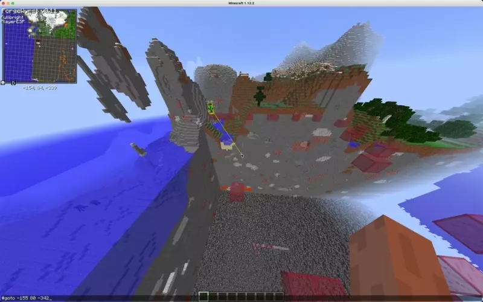
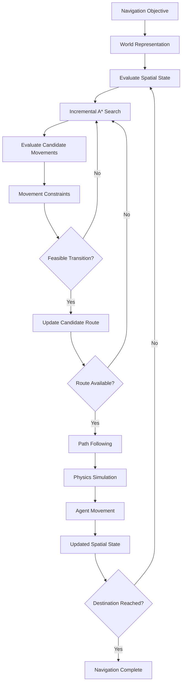
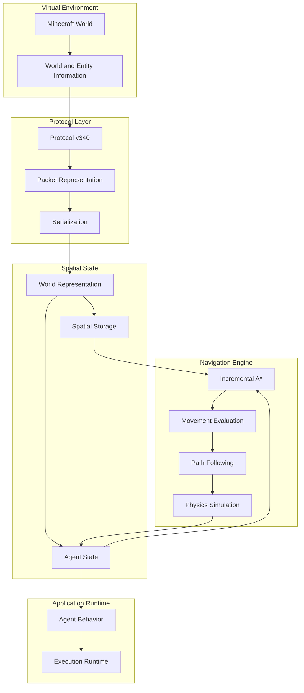

<div align="center">

  <h1>Minecraft Bot Launcher</h1>

  <p>
    <strong>Autonomous navigation in dynamic voxel environments.</strong>
  </p>

  <p>
    A Rust-based exploration of pathfinding, autonomous agents,
    physics simulation, and intelligent movement within Minecraft worlds.
  </p>

  [](https://www.rust-lang.org/)
  [](#compatibility)
  [](#pathfinding-engine)
  [](#architecture)
  [](./LICENSE)

  <p>
    <a href="#overview">Overview</a> ·
    <a href="#pathfinding-engine">Pathfinding</a> ·
    <a href="#architecture">Architecture</a> ·
    <a href="#physics-and-movement">Physics</a> ·
    <a href="#development">Development</a>
  </p>

  

  <sub>Autonomous traversal through complex terrain using pathfinding and physics-aware movement.</sub>

</div>

## Overview

Minecraft Bot Launcher is a Rust-based project that explores autonomous
navigation within three-dimensional voxel environments.

Minecraft provides an interesting computational environment for
studying pathfinding beyond conventional graphs and static grids.
Agents must navigate terrain where movement is influenced by gravity,
obstacles, elevation changes, collision boundaries, and the physical
properties of the surrounding world.

The project combines incremental A* search, movement simulation,
world representation, and a custom Minecraft protocol implementation
into a modular system for autonomous agents.

Rather than depending on the graphical Minecraft client, the
architecture implements the underlying components required to
represent, process, and navigate the virtual environment.

The project explores several interconnected areas of computer science:

- Graph theory and heuristic search.
- Autonomous agent architectures.
- Incremental path planning.
- Voxel-based spatial representation.
- Physics-aware navigation.
- Concurrent systems and asynchronous programming.
- Network protocols and binary serialization.

## Features

| Feature | Description |
| :--- | :--- |
| **Incremental A\*** | Pathfinding through partially known and evolving environments. |
| **Voxel Navigation** | Spatial reasoning over block-based three-dimensional terrain. |
| **Physics Simulation** | Movement governed by gravity, velocity, and collision detection. |
| **Parkour Navigation** | Exploration of movement across gaps and elevation changes. |
| **Path Following** | Translation of computed routes into agent movement. |
| **World Representation** | Spatial storage and representation of Minecraft terrain. |
| **Autonomous Agents** | Independent agent state and movement behavior. |
| **Protocol Implementation** | Native Rust implementation of Minecraft protocol components. |
| **Asynchronous Runtime** | Event-driven execution and asynchronous I/O using Tokio. |
| **Modular Workspace** | Separation of protocol, interfaces, application logic, and command-line components. |

## Pathfinding Engine

The pathfinding engine is responsible for identifying feasible routes
through the spatial environment.

Unlike traditional grid-based pathfinding, movement within Minecraft
cannot be modeled exclusively as transitions between adjacent cells.

A valid transition must also consider environmental geometry,
available space, elevation, and movement constraints.

### Incremental A*

The search engine uses A* as the foundation for evaluating possible
routes through the environment.

The conventional A* evaluation function is expressed as:

$$
f(n) = g(n) + h(n)
$$

Where:

- $g(n)$ represents the accumulated traversal cost.
- $h(n)$ estimates the remaining cost to the destination.
- $f(n)$ determines the evaluation priority of a candidate node.

The incremental approach allows search computation to progress
without treating route planning as a single monolithic operation.

This is particularly relevant in environments where spatial
information may become available progressively.

### Beyond conventional grids

| Conventional Grid Search | Minecraft Navigation |
| :--- | :--- |
| Discrete neighboring cells | Movement-dependent spatial transitions |
| Static obstacle representation | Evolving world information |
| Uniform movement assumptions | Physics-aware movement |
| Simple coordinate traversal | Jumps, falls, and elevation changes |
| Complete environment representation | Potentially incomplete terrain information |
| Computed coordinate sequence | Route execution through an autonomous agent |

The resulting navigation problem involves both identifying a route
and determining whether the agent can physically traverse it.

### Navigation lifecycle

The following conceptual diagram illustrates the relationship between
world representation, path planning, and movement execution.



This relationship between search and movement distinguishes autonomous
navigation from purely mathematical shortest-path problems.

## Architecture

The project is organized around separate responsibilities for
network communication, spatial state, search algorithms, physical
simulation, and agent behavior.

The architecture reflects the interaction between a virtual
environment and the computational systems required to navigate it.



### Core components

| Component | Responsibility |
| :--- | :--- |
| **Pathfinding** | Search strategies and incremental route computation. |
| **Movement Evaluation** | Representation and evaluation of spatial transitions. |
| **Physics** | Simulation of movement and environmental interactions. |
| **Path Following** | Execution of computed navigation routes. |
| **Agent State** | Representation of local and global agent information. |
| **World Storage** | Spatial data structures and terrain representation. |
| **Protocol** | Minecraft communication and packet processing. |
| **Runtime** | Application execution and agent lifecycle management. |

## Physics and Movement

A route is only meaningful when the agent can traverse it according
to the physical constraints of the environment.

The physics layer models movement within the virtual world,
introducing constraints that extend beyond conventional
graph traversal.

These include:

- Gravity and vertical displacement.
- Velocity and acceleration.
- Collision detection.
- Ground and airborne movement.
- Jumping and elevation transitions.
- Environmental interactions.
- Navigation across discontinuous terrain.

### Parkour navigation

Parkour provides a particularly interesting application of
physics-aware pathfinding.

An agent must account for spatial relationships between blocks,
available movement options, elevation differences, and the
physical constraints of each transition.

<div align="center">

  

  <sub>Navigation through discontinuous terrain and elevation changes.</sub>

</div>

This extends the navigation problem from finding connected
coordinates to exploring physically feasible movement.

## World Representation

Minecraft worlds consist of discrete blocks arranged across
three-dimensional space.

This representation provides a practical foundation for studying
voxel-based navigation and spatial search.

A world position can be represented as:

$$
p = (x, y, z)
$$

However, determining whether a position is traversable requires
additional environmental information beyond its coordinates.

The relationship between spatial representation and physical
movement introduces several computational challenges:

| Challenge | Description |
| :--- | :--- |
| **Spatial Complexity** | Navigation across a volumetric environment. |
| **Partial Information** | Spatial reasoning when parts of the environment are unknown. |
| **Dynamic State** | Representation of changing terrain and agent positions. |
| **Movement Feasibility** | Evaluating transitions according to physical constraints. |
| **Computational Cost** | Balancing search complexity with available resources. |

These characteristics make voxel environments an interesting
subject for studying autonomous systems and spatial algorithms.

## Engineering Design

### Native Rust implementation

The project uses Rust to explore systems-level approaches to
autonomous navigation and virtual environment processing.

Rust provides several relevant characteristics for this domain:

| Characteristic | Engineering Relevance |
| :--- | :--- |
| **Memory Safety** | Safe management of application state through ownership and borrowing. |
| **Concurrency** | Structured execution of independent computational tasks. |
| **Static Typing** | Explicit representation of spatial, protocol, and agent data. |
| **Performance** | Native execution without depending on the graphical game client. |
| **Modularity** | Separation of components through modules and workspace crates. |

### Shared process architecture

The underlying application supports multiple autonomous agent
instances within a common process architecture.

This design separates agent-specific state from shared environmental
information, offering an interesting case study in memory management,
state isolation, and concurrent software design.

No specific performance or scalability guarantees are made without
reproducible benchmarks.

## Compatibility

The protocol implementation targets the Minecraft Java Edition
1.12.x generation.

| Environment | Status |
| :--- | :--- |
| Minecraft Java Edition 1.12.x | Legacy implementation |
| Minecraft Java Edition 1.12.2 | Protocol v340 |
| Minecraft Java Edition 1.16 | Not implemented |
| Minecraft Bedrock Edition | Not implemented |
| Modern Minecraft Java Edition | Not verified |

Protocol v340 corresponds specifically to Minecraft Java Edition
1.12.2.

The project contains legacy networking and authentication components.
Compatibility with current Minecraft services is not guaranteed.

## Development

### Requirements

| Dependency | Purpose |
| :--- | :--- |
| Rust | Core application and systems programming |
| Cargo | Dependency management and workspace compilation |
| Rustup | Rust toolchain management |
| Tokio | Asynchronous runtime |
| Rayon | Parallel computation |

The repository includes a pinned Rust toolchain configuration:

```toml
[toolchain]
channel = "nightly-2024-07-04"
```

This preserves the original compiler selection rather than
implicitly relying on the latest stable or nightly compiler.

### Source code

```bash
git clone https://github.com/4beru/minecraft-bot-launcher.git
cd minecraft-bot-launcher
```

Inspect the selected Rust toolchain:

```bash
rustc --version
cargo --version
```

### Workspace validation

Check the workspace for compilation errors:

```bash
cargo check --workspace
```

Run the workspace test suite:

```bash
cargo test --workspace
```

Check source code formatting:

```bash
cargo fmt --all -- --check
```

The repository uses a historical Rust toolchain and dependency
configuration. Additional platform-specific dependencies or
compatibility adjustments may be necessary.

## Project Structure

```text
minecraft-bot-launcher/
│
├── .github/
│   ├── parkour.webp
│   └── workflows/
│
├── src/
│   ├── bootstrap/
│   │
│   ├── client/
│   │   ├── follow/
│   │   ├── pathfind/
│   │   │   ├── bidirectional/
│   │   │   ├── implementations/
│   │   │   ├── incremental/
│   │   │   ├── moves/
│   │   │   └── moves.rs
│   │   │
│   │   ├── physics/
│   │   ├── state/
│   │   │   ├── global/
│   │   │   └── local/
│   │   ├── tasks/
│   │   ├── bot.rs
│   │   └── runner.rs
│   │
│   ├── protocol/
│   │   ├── io/
│   │   └── v340/
│   │
│   ├── storage/
│   ├── schematic.rs
│   ├── types.rs
│   └── main.rs
│
├── interfaces/
├── packets/
│   ├── packets_macro/
│   └── src/
│
├── swarmbot-cli/
├── test-data/
├── Cargo.toml
├── Cargo.lock
├── rust-toolchain.toml
├── rustfmt.toml
├── LICENSE
└── README.md
```

### Source code reference

The following modules provide entry points for exploring
the implementation.

| Module | Source |
| :--- | :--- |
| Incremental Pathfinding | [`src/client/pathfind/incremental/`](./src/client/pathfind/incremental/) |
| Bidirectional Search | [`src/client/pathfind/bidirectional/`](./src/client/pathfind/bidirectional/) |
| Movement Representation | [`src/client/pathfind/moves.rs`](./src/client/pathfind/moves.rs) |
| Physics Simulation | [`src/client/physics/`](./src/client/physics/) |
| Path Following | [`src/client/follow/`](./src/client/follow/) |
| Agent State | [`src/client/state/`](./src/client/state/) |
| World Storage | [`src/storage/`](./src/storage/) |
| Minecraft Protocol | [`src/protocol/v340/`](./src/protocol/v340/) |
| Packet Representation | [`packets/`](./packets/) |
| Shared Interfaces | [`interfaces/`](./interfaces/) |
| Command-Line Components | [`swarmbot-cli/`](./swarmbot-cli/) |

## Technology Stack

<div align="center">

  

</div>

| Technology | Responsibility |
| :--- | :--- |
| **Rust** | Systems programming and algorithm implementation. |
| **Tokio** | Asynchronous execution and I/O. |
| **Rayon** | Parallel computational workloads. |
| **Serde** | Structured data serialization and deserialization. |
| **Clap** | Command-line interface components. |
| **SmallVec** | Stack-oriented storage for small collections. |
| **IndexMap** | Ordered associative data structures. |
| **Cargo** | Workspace management and dependency resolution. |
| **NBT** | Representation of Minecraft-specific structured data. |

## Research and Applications

The project serves as a practical reference for exploring the
relationship between algorithms and interactive environments.

Its concepts are relevant to several areas of software engineering
and computer science:

| Domain | Application |
| :--- | :--- |
| **Artificial Intelligence** | Autonomous agent behavior and heuristic decision-making. |
| **Graph Theory** | Search algorithms and constrained spatial traversal. |
| **Game Development** | Physics-aware character navigation. |
| **Computational Geometry** | Spatial relationships and movement feasibility. |
| **Simulation** | Virtual environments and autonomous movement. |
| **Systems Programming** | Memory management and concurrent execution. |
| **Procedural Environments** | Navigation through complex voxel-based worlds. |

The project is presented for educational exploration and
experimentation in private or explicitly authorized environments.

---

<div align="center">

  <h3>Where algorithms meet virtual worlds.</h3>

  <p>
    Part of <strong>Pathfinding Series</strong> — a collection of
    projects exploring graph theory, search algorithms,
    spatial computing, and creative visualization.
  </p>

  <p>
    <sub>Curated by Abel Ortega.</sub>
  </p>

  <a href="https://github.com/4beru">GitHub</a> ·
  <a href="https://www.aberu.site">Portfolio</a>

</div>
